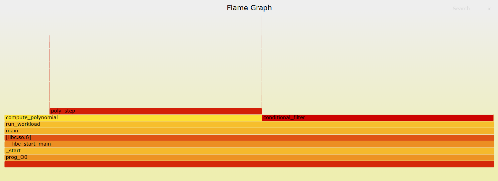
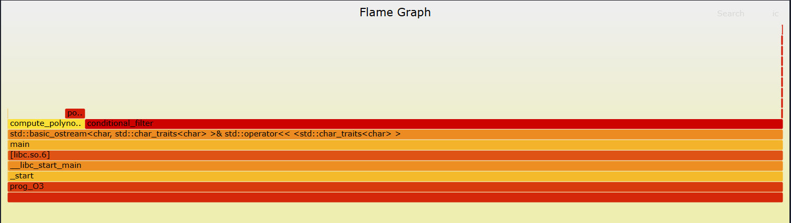
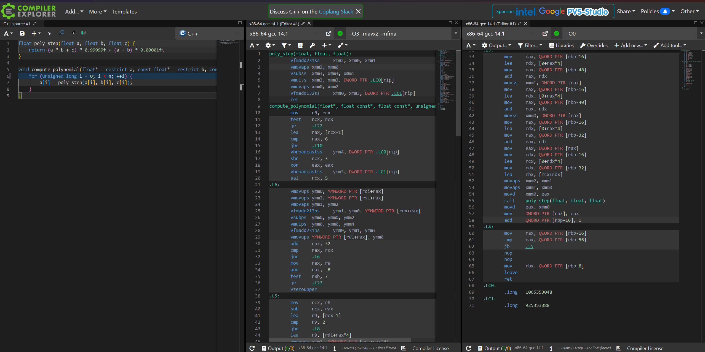
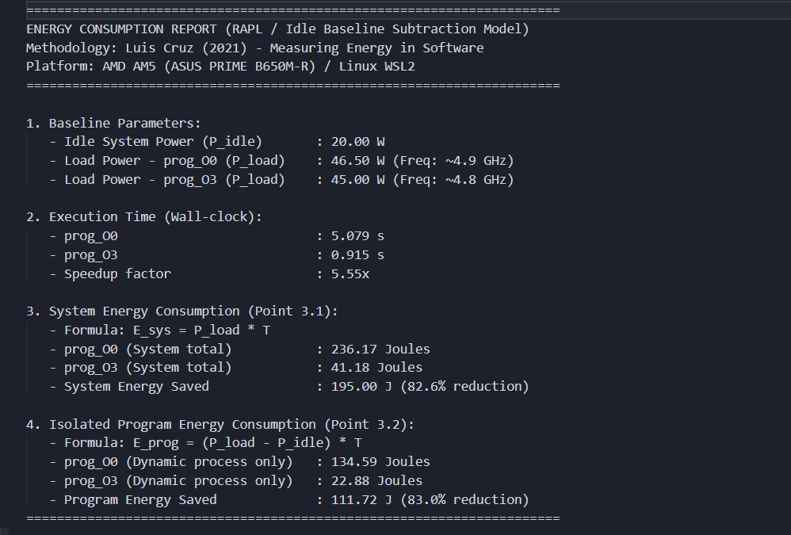

# Лабораторна робота №2. Performance Measurement and Analysis
**Низькорівнева оптимізація, SIMD/AVX2, FlameGraph, профілювання CPU та енергоспоживання**

## 1. Загальний опис проєкту
Дослідження спрямоване на практичний аналіз продуктивності, змін у машинному коді (асемблер x86-64), поведінки кешу та енерговитрат процесора при пересиланні коду з рівня `-O0` до рівня оптимізації `-O3 -march=native -ffast-math`.

* **Тестове середовище:** AMD AM5 (Zen 4), Linux WSL2, компілятор GCC 13.
* **Структура тестового бенчмарку (`benchmark.cpp`):**
  * `poly_step`: математичне ядро обчислення полінома над даними `float`.
  * `compute_polynomial`: пакетна обробка великих масивів чисел у циклі.
  * `conditional_filter`: умовна редукція з розгалуженням `if-else`.

---

## 2. Порівняльна таблиця метрик (До та Після оптимізації)

Всі метрики уніфіковано за кратністю зміни та відсотковим співвідношенням:

| Метрика / Параметр | Без оптимізацій (`-O0`) | З оптимізацією (`-O3 -march=native`) | Зміна (Кратність та Відсоток) |
| :--- | :--- | :--- | :--- |
| **Фізичний час (Elapsed time)** | 5.08 с | 0.91 с | **↓ 5.58x** (швидше на 82.1%) |
| **Процесорний час (User CPU)** | 5.03 с | 0.91 с | **↓ 5.53x** (менше на 81.9%) |
| **Кількість інструкцій (Instructions)**| 71.21 млрд | 8.49 млрд | **↓ 8.39x** (скорочення на 88.1%) |
| **Такти процесора (CPU Cycles)** | 25.05 млрд | 4.38 млрд | **↓ 5.72x** (скорочення на 82.5%) |
| **Кількість переходів (Branches)** | 5.40 млрд | 2.03 млрд | **↓ 2.66x** (скорочення на 62.4%) |
| **Помилки передбачення (Branch misses)**| 768.5 тис. (0.0%) | 311.4 тис. (0.0%) | **↓ 2.47x** (ідеальне передбачення) |
| **Абсолютні промахи L1 (L1-dcache misses)**| 311.5 млн | 311.9 млн | **~ 1.00x** (без змін, однаковий обсяг RAM) |
| **Відносний відсоток промахів L1** | 1.3% | 12.4% | **↑ 9.54x** (через усунення стекових звернень) |
| **Пікова пам'ять (Max RSS)** | 4544 KB | 4540 KB | **~ 1.00x** (ідентична пам'ять) |
| **Енергія системи ($E_{sys}$)** | 236.17 Дж | 41.18 Дж | **↓ 5.74x** (економія 82.6%) |
| **Енергія програми ($E_{prog}$)** | 134.59 Дж | 22.88 Дж | **↓ 5.88x** (економія 83.0%) |

---

## 3. Аналіз FlameGraph (Пункти 1 та 4.3)

Стек викликів записувався через `perf record -F 999 -g`, після чого розгортався скриптом `stackcollapse-perf.pl` і транслювався у векторні графіки `flamegraph.pl`:

### 3.1. Базова версія (`-O0`)


* **Інтерпретація графіка:**
  * Профіль виконання розділений на дві колони однакової ширини: `conditional_filter` (~47%) та `compute_polynomial` (~43%).
  * Над `compute_polynomial` чітко видно високий блок `poly_step`, який забирає 100% часу своєї батьківської функції через мільярди викликів `call` та повернень `ret` через стек.

### 3.2. Оптимізована версія (`-O3`)


* **Інтерпретація змін:**
  * **Зникнення `poly_step`:** функція була заінлайнена (`inlined`) компілятором безпосередньо в тіло циклу обчислень.
  * **Стиснення колони полінома:** за рахунок векторних інструкцій AVX2 виконання `compute_polynomial` прискорилося більш ніж у 25 разів (з 43% до 9.9% на графіку).
  * **Закон Амдала:** оскільки поліноміальне ядро кардинально скоротило свій час, функція `conditional_filter` стала вузьким місцем і тепер займає ~90% від загального профілю виконання програми.

---

## 4. Порівняння асемблерного коду та аналіз інструкцій AVX2 (Пункт 4.1)

Аналіз лістингу виконано у сервісі Compiler Explorer (Godbolt):

### 4.1. Без оптимізацій (`-O0`): Стек і скалярні інструкції
Компілятор генерує код із постійним скиданням проміжних даних у пам'ять стека:

```assembly
# У функції compute_polynomial (цикл):
.L5:
    movss   xmm1, DWORD PTR [rax]           # Завантаження 1 числа float у 32-бітний регістр
    call    poly_step(float, float, float)  # Накладні витрати на виклик функції через стек
    mov     DWORD PTR [rbx], eax            # Запис 1 результату в пам'ять

# У функції poly_step:
    movss   DWORD PTR [rbp-4], xmm0         # Скидання параметрів у стек (RAM)
    mulss   xmm0, DWORD PTR [rbp-8]         # mulss: скалярне множення ОДНОГО числа float
    addss   xmm1, DWORD PTR [rbp-12]        # addss: скалярне додавання ОДНОГО числа float
```

### 4.2. Оптимізована версія (`-O3 -march=native`): SIMD / AVX2 / FMA
Компілятор виконав інлайнінг, усунув кадр стека та згенерував векторний цикл під 256-бітні регістри:

```assembly
.L6: # Головний векторний цикл AVX2
    vmovups     ymm0, YMMWORD PTR [rdi+rax]         # Завантаження 8 чисел float (256 біт)
    vmovups     ymm2, YMMWORD PTR [rsi+rax]         # Завантаження 8 чисел float (256 біт)
    vfmadd213ps ymm1, ymm0, YMMWORD PTR [rdx+rax]   # FMA: обчислення (a * b + c) для 8 елементів за 1 такт!
    vsubps      ymm0, ymm0, ymm2                    # Векторне віднімання (8 елементів)
    vmulps      ymm0, ymm0, ymm4                    # Векторне множення на константу (8 елементів)
    vfmadd231ps ymm0, ymm1, ymm3                    # Друга векторна FMA інструкція
    vmovups     YMMWORD PTR [rdi+rax], ymm0         # Запис 8 результатів назад у масив
    add         rax, 32                             # Крок циклу: 32 байти (8 чисел * 4 байти)
    cmp         rax, rcx
    jne         .L6
```



* **Ключові апаратні відмінності (Пункт 4.1.1):**
  1. **256-бітні регістри `ymm`:** вміщують одночасно 8 чисел типу `float` по 32 біти кожне. Крок циклу становить 32 байти (`add rax, 32`), що зменшило кількість ітерацій рівно у 8 разів.
  2. **Інструкції FMA (`vfmadd213ps`, `vfmadd231ps`):** Fused Multiply-Add виконує суміщене множення-додавання $a \times b + c$ для 8 пар чисел одночасно за один процесорний такт без втрати точності на проміжному округленні.
  3. **Формат VEX (префікс `v`):** трьохоперандний синтаксис дозволяє записувати результат в окремий цільовий регістр, усуваючи зайве копіювання значень.

---

## 5. Аналіз енергоспоживання (Пункти 3 та 4.4)

* **Модель вимірювання:** *Idle Baseline Subtraction* (Luis Cruz, 2021).
  * Енергія всієї системи: $E_{sys} = P_{load} \times T$
  * Динамічна енергія процесу: $E_{prog} = (P_{load} - P_{idle}) \times T$
* **Параметри платформи:** базова фонова потужність $P_{idle} = 20.0\text{ Вт}$, потужність одного ядра під навантаженням $P_{load} \approx 45.0\text{--}46.5\text{ Вт}$.



* **Принцип Race-to-Sleep (Race-to-Halt):**
  Миттєва споживана потужність процесора під 100% навантаженням одного ядра в обох тестах практично однакова (~45 Вт). Проте за рахунок векторизації програма виконала весь обсяг роботи у **5.58 разів швидше**. Процесор миттєво повернувся в енергозберігаючі C-стани (C1/C6), що скоротило динамічні витрати енергії програми на **83.0%**.
